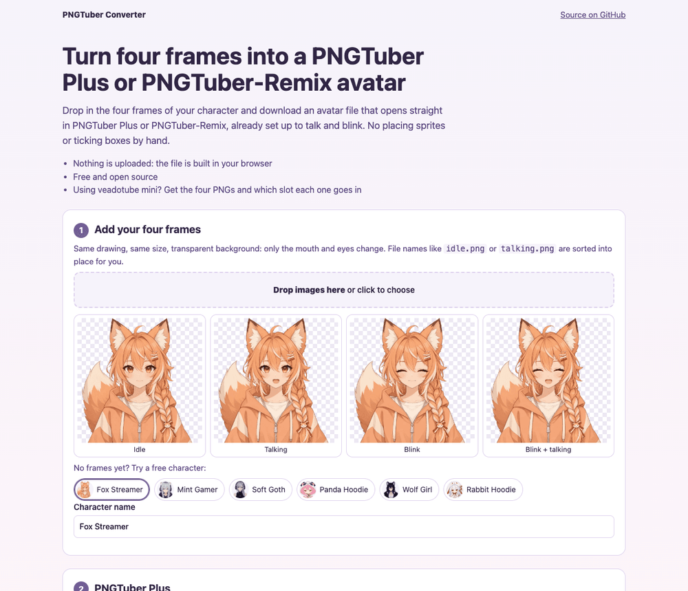

# PNGTuber Converter

Turn the four frames of your PNGTuber into an avatar file that opens straight
in **PNGTuber Plus** or **PNGTuber-Remix**, already set up to talk and blink.
Or get the four PNGs in a ZIP, with the slot each one goes in for
**veadotube mini**.

**Use it here: https://pngtubermaker.github.io/pngtuber-converter/**



## The four frames

| Frame | Mouth | Eyes |
|---|---|---|
| `idle.png` | closed | open |
| `talking.png` | open | open |
| `blink.png` | closed | closed |
| `blink-talking.png` | open | closed |

All four the same size, with a transparent background. File names like these
are sorted into place automatically. No frames yet? The page has six free
sample characters.

## What you get

**PNGTuber Plus (`.save`)**: four sprites, each shown only in its own state
(`showTalk` / `showBlink`), with the images embedded. PNGTuber Plus's Load
window only browses its own data folder, so move the file there first: press
**Esc** in PNGTuber Plus to open it (`%APPDATA%\Godot\app_userdata\PNGTuberPlus`
on Windows, `~/Library/Application Support/Godot/app_userdata/PNGTuberPlus` on
macOS), then click **Load**. Frames are scaled to 600 px by default so the
avatar fits the default window; hold **Ctrl** and scroll to zoom.

**PNGTuber-Remix (`.pngRemix`)**: a model with four sprites set by
`should_talk` / `open_mouth` and `should_blink` / `open_eyes`, written in the
per-sprite image layout that versions 1.3.5 through 1.4.7 open. Open it with
**Files → Open** or drag it onto the window.

**ZIP**: the four PNGs plus a README that says which veadotube mini slot each
one goes in.

## How it was checked

- PNGTuber Plus: a `.save` built by this page was loaded by PNGTuber Plus
  1.4.5's own code, which showed exactly one frame in each of the four
  talk/blink states.
- PNGTuber-Remix: a `.pngRemix` built by this page was decoded by Godot 4's
  `FileAccess.get_var()` into the structure Remix's loader reads, with every
  embedded PNG decoding. It has not yet been opened in the Remix app itself
  (Remix ships for Windows and Linux). If it doesn't load in yours, please
  open an issue with your Remix version.

## Development

No build step and no dependencies. `converter.js` holds the encoders (PNGTuber
Plus JSON, a Godot 4 binary Variant writer, a ZIP writer); `app.js` is the page.

```sh
node --test   # unit tests for the encoders
```

The page loads the sample characters from the
[PNGTuber OBS Player](https://github.com/pngtubermaker/pngtuber-obs-player)
site next to it, so serve both folders from one directory when developing.

## Not affiliated

This is an independent tool that writes files these apps open. PNGTuber Plus
is by kaiakairos, PNGTuber-Remix by MudkipWorld, and veadotube by olmewe.

## Need a character?

[PNGTuber Maker](https://pngtubermaker.net/) is an AI PNGTuber generator:
describe a character or upload a reference image, pick one of four designs,
and get the four frames this converter needs.

## License

MIT: see [LICENSE](LICENSE). The sample characters are not covered by it; see
the OBS Player repository for their terms.
